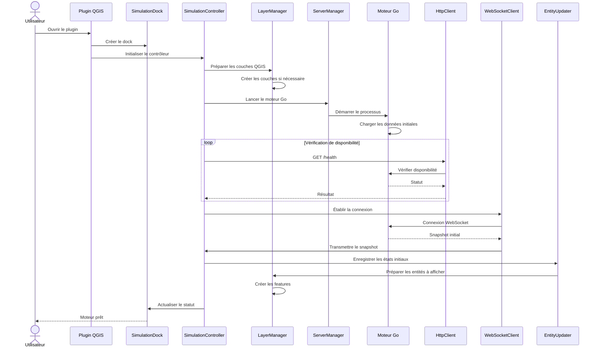
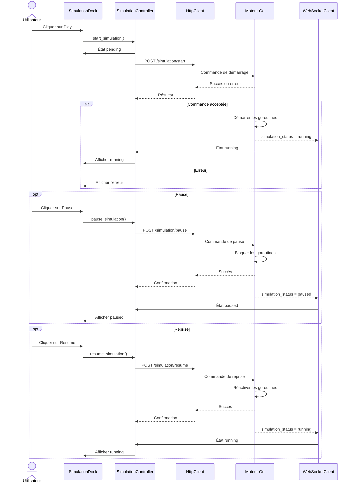
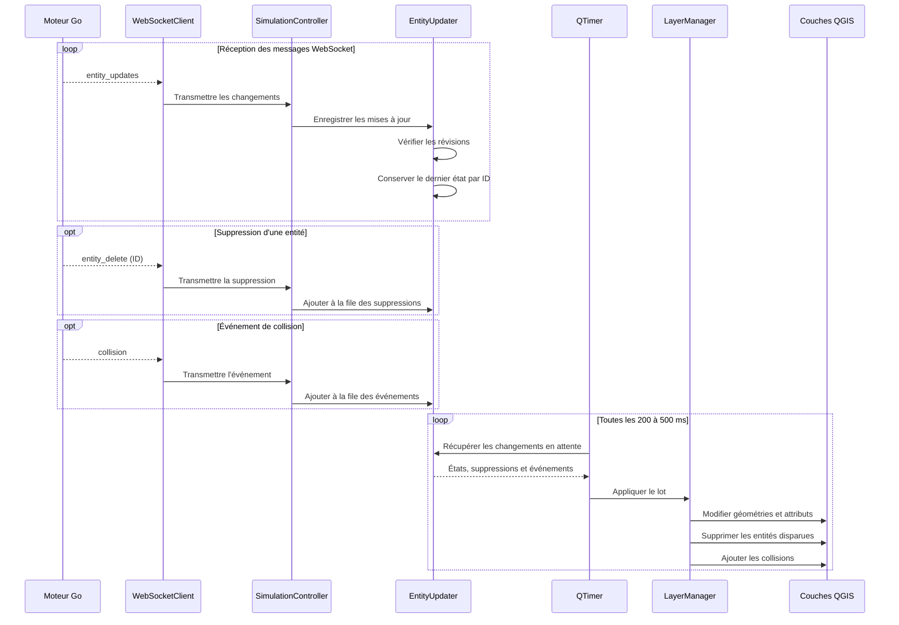
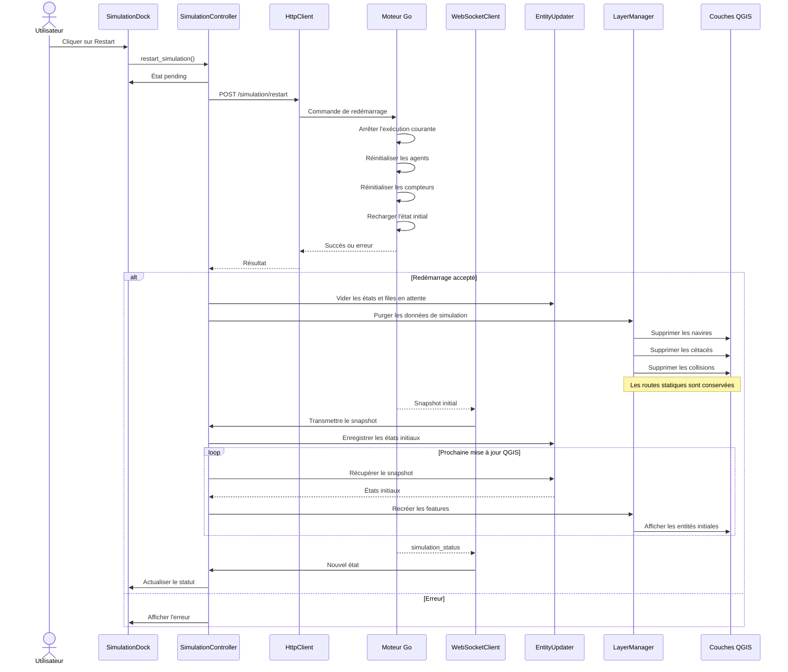
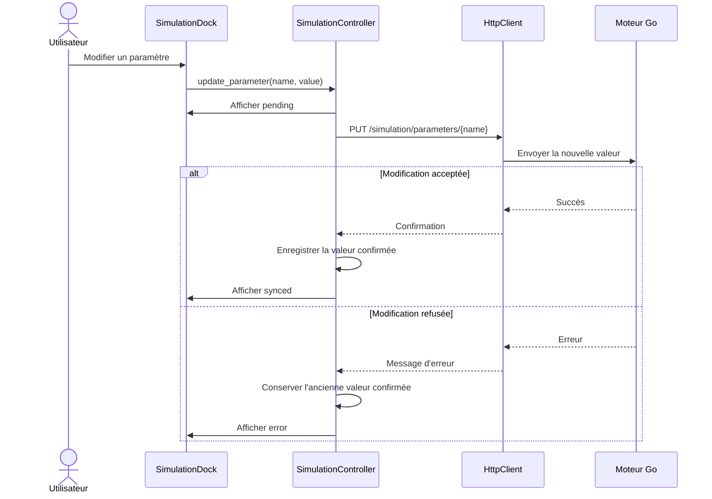
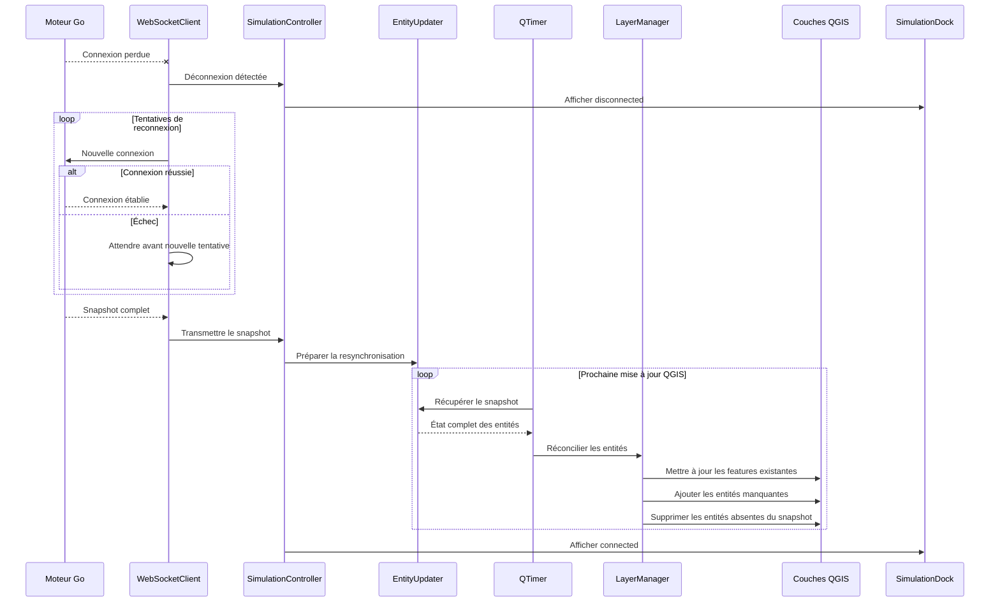
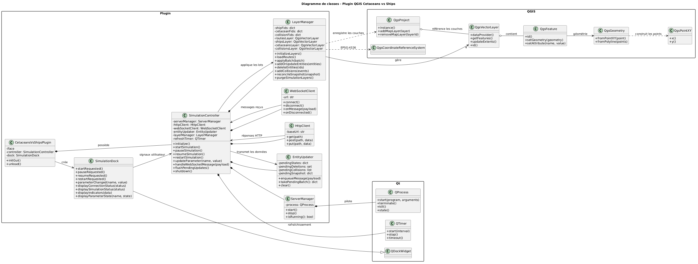

#### **Les trois types de messages WebSocket à prévoir**

**1. Initialisation / snapshot**

```
{
  "type": "snapshot",
  "entities": [
    {
      "id": "ship_001",
      "entity_type": "ship",
      "coordinates": {
        "longitude": -15.42,
        "latitude": 28.13
      },
      "rotation": 120.0,
      "extra": {
        "speed": 15.0
      }
    },
    {
      "id": "cetacean_001",
      "entity_type": "cetacean",
      "coordinates": {
        "longitude": -15.40,
        "latitude": 28.15
      },
      "rotation": 90.0,
      "extra": {
        "species": "dolphin"
      }
    }
  ]
}
```

**2. Mise à jour d'une entité**

```
{
  "type": "entity_update",
  "id": "ship_001",
  "entity_type": "ship",
  "coordinates": {
    "longitude": -15.40,
    "latitude": 28.14
  },
  "rotation": 125.0,
  "extra": {
    "speed": 14.5
  }
}
```

**3. Événement de collision**

```
{
  "type": "collision",
  "id": "collision_001",
  "coordinates": {
    "longitude": -15.39,
    "latitude": 28.15
  },
  "extra": {
    "ship_id": "ship_001",
    "cetace_id": "cetacean_001",
    "fatal": false
  }
}
```

L'avantage est que Python n'aura qu'un seul mécanisme de réception et de traitement des messages.

#### Séquence 1 - Chargement du plugin et initialisation



#### Séquence 2 - Démarrage et contrôle de la simulation



#### Séquence 3 - Actualisation des entités géographiques



#### Séquence 4 - Redémarrage et purge des entités



#### Séquence 5 - Modification d'un paramètre



#### Séquence 6 - Déconnexion et resynchronisation



### **Synthèse des responsabilités**

|Composant|Responsabilité|
|---|---|
|`Plugin`|Cycle de vie du plugin QGIS|
|`SimulationDock`|Interface et interactions utilisateur|
|`SimulationController`|Orchestration générale|
|`ServerManager`|Démarrage et arrêt du processus Go|
|`HttpClient`|Envoi des commandes REST|
|`WebSocketClient`|Réception des messages du moteur|
|`EntityUpdater`|Gestion des changements, suppressions et événements en attente|
|`LayerManager`|Création, modification et suppression des features QGIS|

### Diagramme de classe

```plantuml

@startuml
title Diagramme de classes - Plugin QGIS Cetaceans vs Ships

left to right direction
skinparam classAttributeIconSize 0
skinparam packageStyle rectangle

package "Plugin" {

    class CetaceansVsShipsPlugin {
        - iface
        - controller: SimulationController
        - dock: SimulationDock
        + initGui()
        + unload()
    }

    class SimulationDock {
        + startRequested()
        + pauseRequested()
        + resumeRequested()
        + restartRequested()
        + parameterChanged(name, value)
        + displayConnectionStatus(status)
        + displaySimulationStatus(status)
        + displayIndicators(data)
        + displayParameterState(name, state)
    }

    class SimulationController {
        - serverManager: ServerManager
        - httpClient: HttpClient
        - webSocketClient: WebSocketClient
        - entityUpdater: EntityUpdater
        - layerManager: LayerManager
        - refreshTimer: QTimer
        + initialize()
        + startSimulation()
        + pauseSimulation()
        + resumeSimulation()
        + restartSimulation()
        + updateParameter(name, value)
        + handleWebSocketMessage(payload)
        + flushPendingUpdates()
        + shutdown()
    }

    class ServerManager {
        - process: QProcess
        + start()
        + stop()
        + isRunning(): bool
    }

    class HttpClient {
        - baseUrl: str
        + get(path)
        + post(path, data)
        + put(path, data)
    }

    class WebSocketClient {
        - url: str
        + connect()
        + disconnect()
        + onMessage(payload)
        + onDisconnected()
    }

    class EntityUpdater {
        - pendingStates: dict
        - pendingDeletions: set
        - pendingCollisions: list
        - pendingSnapshot: dict
        + enqueueMessage(payload)
        + takePendingBatch(): dict
        + clear()
    }

    class LayerManager {
        - shipFids: dict
        - cetaceanFids: dict
        - collisionFids: dict
        - routesLayer: QgsVectorLayer
        - shipsLayer: QgsVectorLayer
        - cetaceansLayer: QgsVectorLayer
        - collisionsLayer: QgsVectorLayer
        + initializeLayers()
        + loadRoutes()
        + applyBatch(batch)
        + addOrUpdateEntities(entities)
        + deleteEntities(ids)
        + addCollisions(events)
        + reconcileSnapshot(snapshot)
        + purgeSimulationLayers()
    }
}

package "Qt" {

    class QDockWidget

    class QTimer {
        + start(interval)
        + stop()
        + timeout()
    }

    class QProcess {
        + start(program, arguments)
        + terminate()
        + kill()
        + state()
    }
}

package "QGIS" {

    class QgsProject {
        + instance()
        + addMapLayer(layer)
        + removeMapLayer(layerId)
    }

    class QgsVectorLayer {
        + dataProvider()
        + getFeatures()
        + updateExtents()
        + id()
    }

    class QgsFeature {
        + id()
        + setGeometry(geometry)
        + setAttribute(name, value)
    }

    class QgsGeometry {
        + fromPointXY(point)
        + fromPolyline(points)
    }

    class QgsPointXY {
        + x()
        + y()
    }

    class QgsCoordinateReferenceSystem
}

' Relations du plugin

CetaceansVsShipsPlugin --> SimulationDock : crée
CetaceansVsShipsPlugin *-- SimulationController : possède

SimulationDock --|> QDockWidget
SimulationDock --> SimulationController : signaux utilisateur

SimulationController *-- ServerManager
SimulationController *-- HttpClient
SimulationController *-- WebSocketClient
SimulationController *-- EntityUpdater
SimulationController *-- LayerManager
SimulationController *-- QTimer : rafraîchissement

ServerManager *-- QProcess : pilote

WebSocketClient --> SimulationController : messages reçus
HttpClient --> SimulationController : réponses HTTP

SimulationController --> EntityUpdater : transmet les données
SimulationController --> LayerManager : applique les lots

' Relations QGIS

LayerManager ..> QgsProject : enregistre les couches
LayerManager --> "4" QgsVectorLayer : gère
QgsProject o-- QgsVectorLayer : référence les couches

QgsVectorLayer o-- QgsFeature : contient
QgsFeature --> QgsGeometry : géométrie
QgsGeometry ..> QgsPointXY : construit les points

LayerManager ..> QgsCoordinateReferenceSystem : EPSG:4326

@enduml
```





## **Détail des responsabilités**

### **Classes du plugin**

|Classe|Responsabilité|Ce qu'elle ne fait pas|
|---|---|---|
|`CetaceansVsShipsPlugin`|Point d'entrée QGIS, création et destruction du plugin|Ne gère pas directement la simulation|
|`SimulationDock`|Affichage, boutons, paramètres, indicateurs|Ne communique pas directement avec Go|
|`SimulationController`|Orchestration de toutes les opérations|Ne calcule aucune donnée métier|
|`ServerManager`|Cycle de vie du processus Go|Ne contrôle pas l'état des goroutines|
|`HttpClient`|Requêtes REST et réponses|Ne décide pas des actions à effectuer|
|`WebSocketClient`|Connexion persistante et réception des messages|Ne modifie pas les couches QGIS|
|`EntityUpdater`|Regroupement des mises à jour, suppressions et événements|Ne manipule aucun objet QGIS|
|`LayerManager`|Création et actualisation des couches géographiques|Ne calcule aucun déplacement ou collision|

### `SimulationController` **: le point central**

C'est la classe qui coordonne les autres composants.

Elle reçoit les demandes de l'interface, déclenche les commandes HTTP, reçoit les messages WebSocket et organise les actualisations QGIS.

Elle possède également le `QTimer` qui déclenche `flushPendingUpdates()`.

Je ne créerais pas de classe supplémentaire pour gérer le cycle de rafraîchissement : une méthode du contrôleur suffit.

### `EntityUpdater` **: un tampon, pas un modèle métier**

Cette classe ne représente pas les navires ou les cétacés.

Elle conserve uniquement les données en attente de traitement :

- `pendingStates` : dernier état reçu pour chaque entité ;
    
- `pendingDeletions` : identifiants des entités à supprimer ;
    
- `pendingCollisions` : événements de collision à ajouter ;
    
- `pendingSnapshot` : état complet à réconcilier après initialisation ou reconnexion.
    

Une fois le lot récupéré par `takePendingBatch()`, le contrôleur le transmet au `LayerManager`.

Pour les mises à jour ordinaires, le dernier état d'une entité remplace le précédent. Pour les collisions, on conserve les événements distincts afin de ne pas perdre l'historique.

### `LayerManager` **: l'unique gestionnaire des couches**

Il possède les références vers les quatre couches :

|Attribut|Type QGIS|Géométrie|Rôle|
|---|---|---|---|
|`routesLayer`|`QgsVectorLayer`|LineString|Routes prédéfinies|
|`shipsLayer`|`QgsVectorLayer`|Point|Positions des navires|
|`cetaceansLayer`|`QgsVectorLayer`|Point|Positions des cétacés|
|`collisionsLayer`|`QgsVectorLayer`|Point|Événements de collision|

Les couches de navires, cétacés et collisions sont des couches mémoire. Les routes sont chargées à l'initialisation et conservées lors d'un Restart.

Les correspondances entre identifiants Go et FID QGIS sont conservées dans `LayerManager`. Cela permet de retrouver rapidement une feature à modifier ou supprimer, sans parcourir toute la couche à chaque mise à jour.

Pour appliquer un lot, le gestionnaire utilise les méthodes du fournisseur de la couche, notamment `addFeatures()`, `changeGeometryValues()`, `changeAttributeValues()` et `deleteFeatures()`, selon les opérations à réaliser et les capacités du fournisseur.

`QgsProject.instance()` sert à enregistrer les couches dans le projet courant. QGIS prend alors en charge leur cycle de vie dans le projet.

## **4. Correspondance avec les diagrammes de séquence**

|Diagramme de séquence|Classes impliquées|
|---|---|
|Initialisation|`CetaceansVsShipsPlugin`, `SimulationController`, `ServerManager`, `HttpClient`, `WebSocketClient`, `LayerManager`, `EntityUpdater`|
|Play / Pause / Resume|`SimulationDock`, `SimulationController`, `HttpClient`, `WebSocketClient`|
|Mises à jour et suppressions|`WebSocketClient`, `SimulationController`, `EntityUpdater`, `QTimer`, `LayerManager`|
|Restart et purge|`SimulationDock`, `SimulationController`, `HttpClient`, `EntityUpdater`, `LayerManager`|
|Modification des paramètres|`SimulationDock`, `SimulationController`, `HttpClient`|
|Déconnexion / reconnexion|`WebSocketClient`, `SimulationController`, `EntityUpdater`, `LayerManager`|

Les responsabilités sont donc cohérentes entre les deux vues UML : les diagrammes de séquence montrent les échanges, tandis que le diagramme de classes montre les composants qui les réalisent.

## **5. Quelques choix techniques à conserver**

**1. Ne pas faire hériter** `LayerManager` **de** `QgsVectorLayer`**.** Il gère les couches, mais n'est pas lui-même une couche QGIS.

**2. Ne pas créer de classes** `Ship`**,** `Cetacean` **ou** `Collision`**.** Les données reçues restent des structures simples jusqu'à leur conversion en `QgsFeature`.

**3. Ne pas faire manipuler QGIS par** `WebSocketClient`**.** Il transmet des données Python ordinaires au contrôleur ; seul le `LayerManager` touche aux couches.

**4. Ne pas confondre les deux horloges.** Le temps simulé vient de Go ; le `QTimer` sert uniquement à cadencer l'actualisation graphique.

**5. Ne pas imposer une bibliothèque réseau dans le diagramme.** `HttpClient` et `WebSocketClient` sont des abstractions du plugin. Le choix de leur implémentation pourra être fait lors du développement.

**6. Conserver EPSG:4326 et l'ordre des coordonnées.** Le moteur transmet longitude puis latitude ; le point QGIS est construit avec `QgsPointXY(longitude, latitude)`.