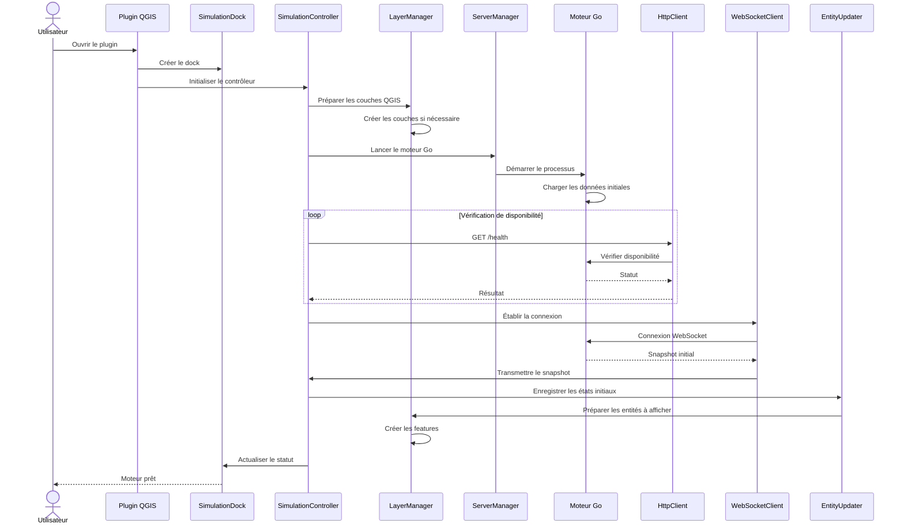
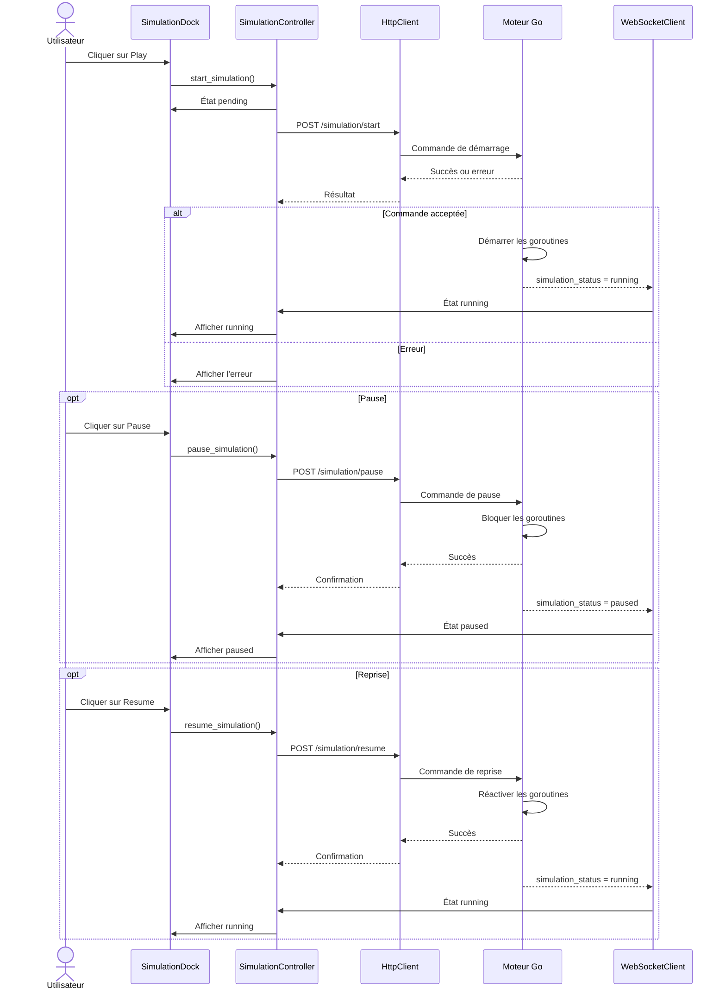
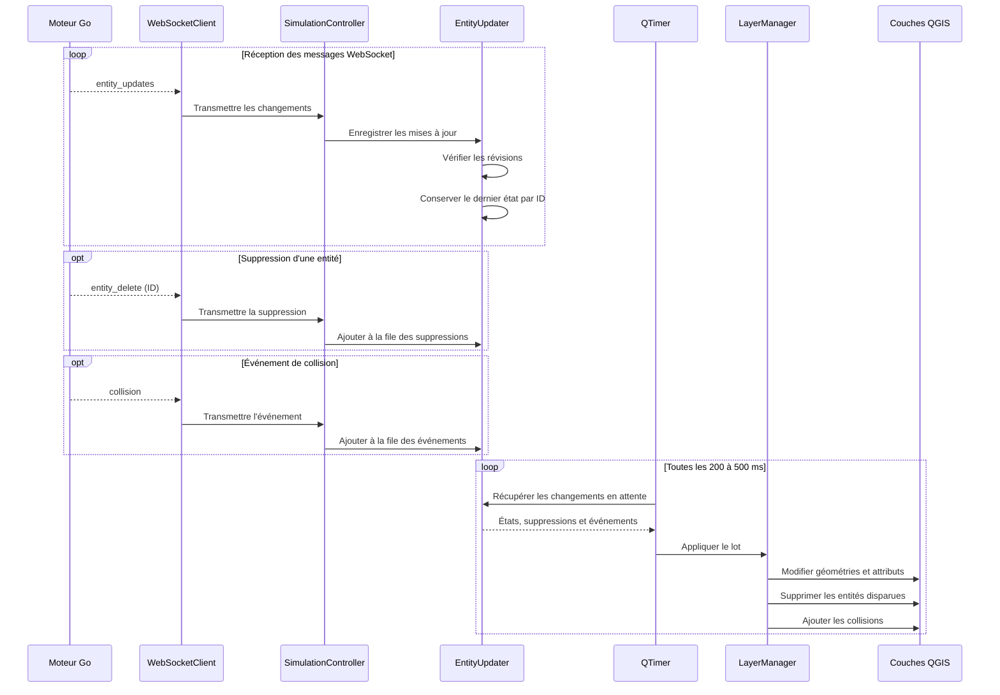
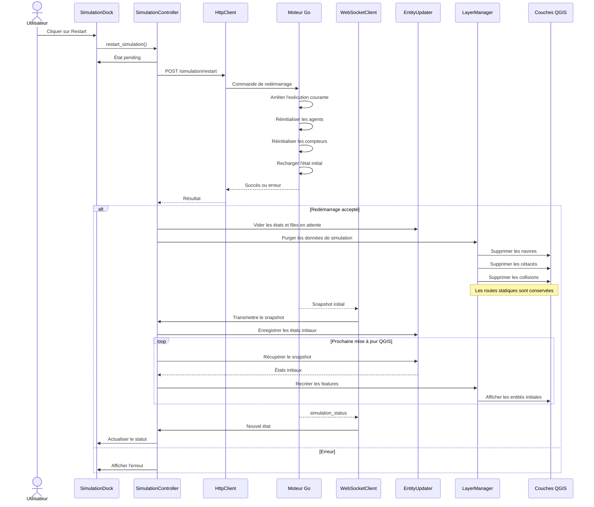
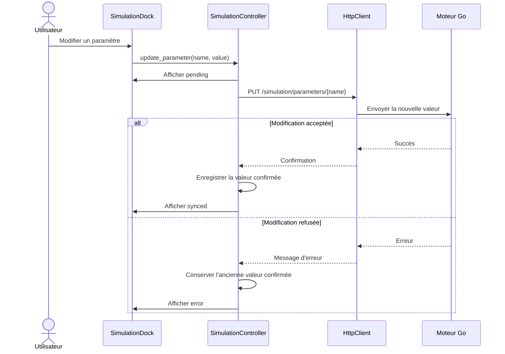
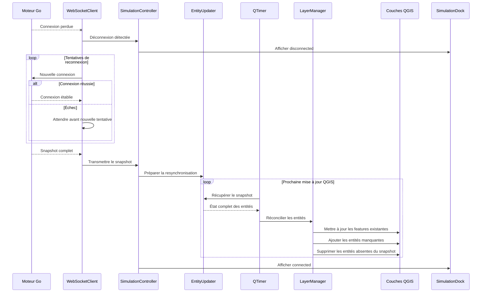

#### **Les trois types de messages WebSocket à prévoir**

**1. Initialisation / snapshot**

```
{
  "type": "snapshot",
  "entities": [
    {
      "id": "ship_001",
      "entity_type": "ship",
      "coordinates": {
        "longitude": -15.42,
        "latitude": 28.13
      },
      "rotation": 120.0,
      "extra": {
        "speed": 15.0
      }
    },
    {
      "id": "cetacean_001",
      "entity_type": "cetacean",
      "coordinates": {
        "longitude": -15.40,
        "latitude": 28.15
      },
      "rotation": 90.0,
      "extra": {
        "species": "dolphin"
      }
    }
  ]
}
```

**2. Mise à jour d'une entité**

```
{
  "type": "entity_update",
  "id": "ship_001",
  "entity_type": "ship",
  "coordinates": {
    "longitude": -15.40,
    "latitude": 28.14
  },
  "rotation": 125.0,
  "extra": {
    "speed": 14.5
  }
}
```

**3. Événement de collision**

```
{
  "type": "collision",
  "id": "collision_001",
  "coordinates": {
    "longitude": -15.39,
    "latitude": 28.15
  },
  "extra": {
    "ship_id": "ship_001",
    "cetace_id": "cetacean_001",
    "fatal": false
  }
}
```

L'avantage est que Python n'aura qu'un seul mécanisme de réception et de traitement des messages.

#### Séquence 1 - Chargement du plugin et initialisation



#### Séquence 2 - Démarrage et contrôle de la simulation



#### Séquence 3 - Actualisation des entités géographiques



#### Séquence 4 - Redémarrage et purge des entités



#### Séquence 5 - Modification d'un paramètre



#### Séquence 6 - Déconnexion et resynchronisation



### **Synthèse des responsabilités**

|Composant|Responsabilité|
|---|---|
|`Plugin`|Cycle de vie du plugin QGIS|
|`SimulationDock`|Interface et interactions utilisateur|
|`SimulationController`|Orchestration générale|
|`ServerManager`|Démarrage et arrêt du processus Go|
|`HttpClient`|Envoi des commandes REST|
|`WebSocketClient`|Réception des messages du moteur|
|`EntityUpdater`|Gestion des changements, suppressions et événements en attente|
|`LayerManager`|Création, modification et suppression des features QGIS|